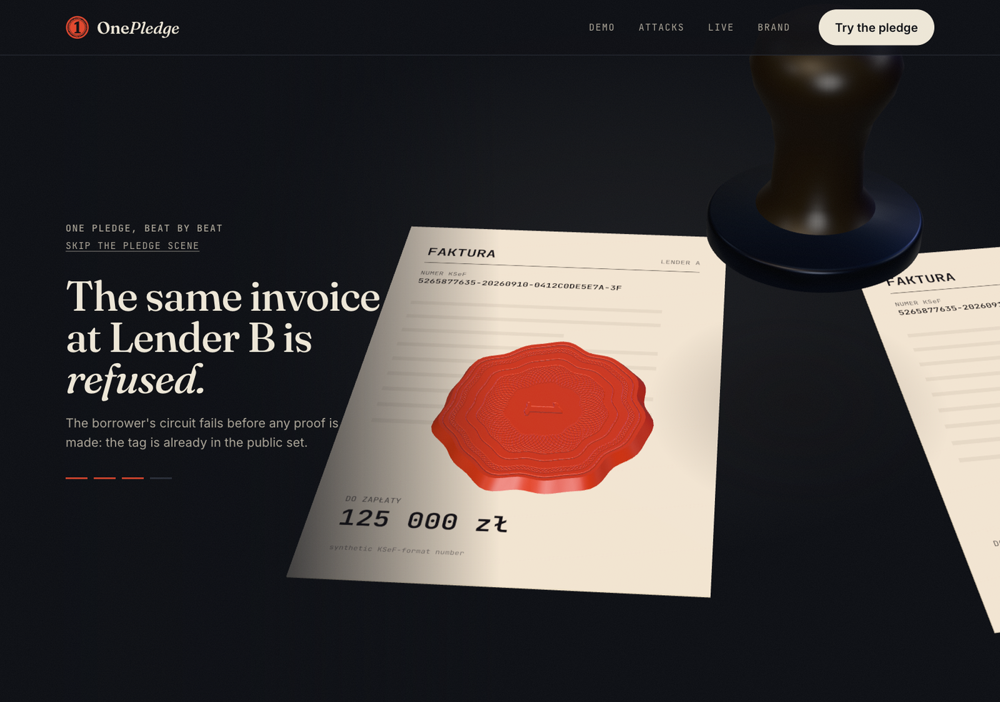
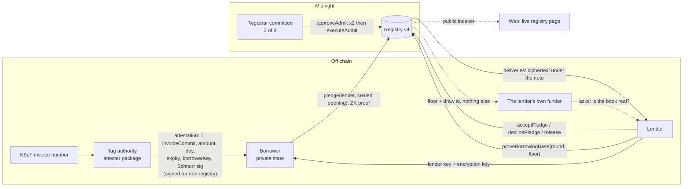
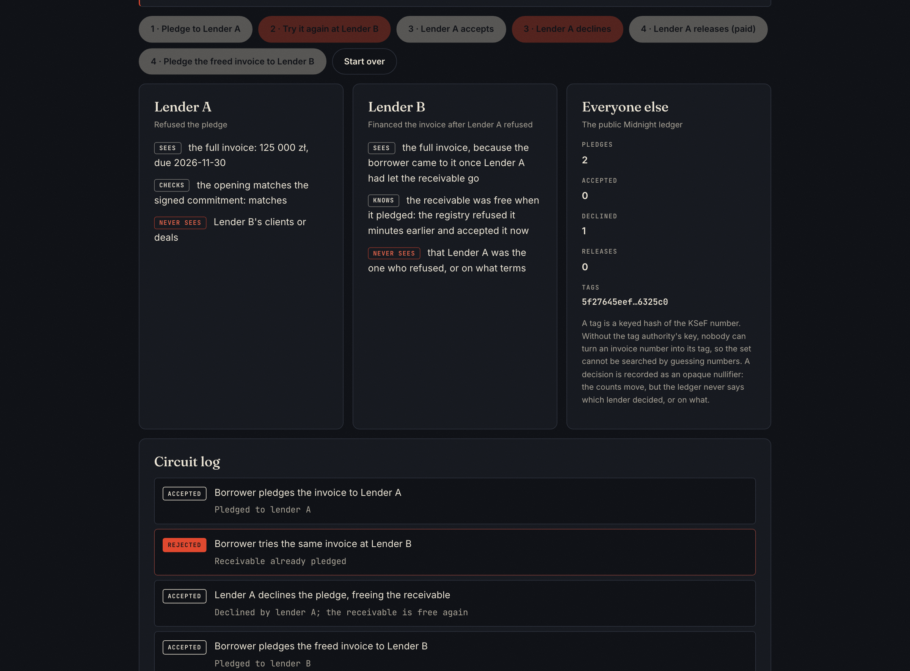

# OnePledge

**One pledge per receivable, across rival lenders, without any lender seeing another's book.**

OnePledge is a registry on [Midnight](https://midnight.network) that refuses to let the same invoice be financed twice. A borrower proves, in zero knowledge, that the tag authority attested an invoice for this registry and that the invoice has never been pledged. The public ledger stores an opaque tag and a note commitment. The financing lender learns the invoice; a rival lender learns only that it is already pledged; the tag authority learns that its invoice was pledged but not to whom; the public learns neither the invoice nor the lender.

Wave 2 added the half of the story a real lender asks about next. A lender that financed receivables can
prove to **its own** funder that four of them are together worth at least a public floor, without naming the
receivables, the amounts or itself (`proveBorrowingBase`). The note opening now reaches the lender
**encrypted on chain**, found by trial decryption, with nothing saying who a delivery is for. And the single
registrar key is gone: admitting a lender takes **two of three registrars**, and no approval says which two.

This project is built on the Midnight Network.

<!-- links:start -->
| | |
|---|---|
| Start here (3 minutes, no install) | 1. [Walkthrough](https://onepledge.vercel.app/demo): pledge, refused double pledge, release. 2. [Attacks](https://onepledge.vercel.app/attacks): why a public hash registry fails. 3. [Live registry](https://onepledge.vercel.app/live): the deployed Preprod contract, read in your browser. Then [How to evaluate](#how-to-evaluate). |
| Live demo | [onepledge.vercel.app](https://onepledge.vercel.app): the landing page's 3D scene tells the pledge in four beats; the walkthrough runs the compiled circuits in your browser; the Live page reads Preprod; `/desk` submits a real pledge from your own wallet |
| Proof | The [deployment table below](#live-on-midnight-preprod) is generated from `deployments/preprod.json`, never typed by hand · `npm run verify:onchain` matches every circuit's verifier key against the chain · 272 tests in CI · our own reviews found and fixed two real bugs, published in full: [F01](docs/security-review.md#f01-critical-one-attestation-could-be-pledged-256-times) in Wave 1, and [F70](docs/security-review.md#f70-high-one-receivable-could-be-counted-twice-in-a-borrowing-base) this wave — repaired on the live contract in place, then the attack re-run against it and refused |
| Demo video | Wave 1: [youtu.be/tftA-AMT9VQ](https://youtu.be/tftA-AMT9VQ) (1:42): the problem, the refused second pledge, and the Preprod transactions behind it. The Wave 2 video is not recorded yet. |
| Deck | [docs/OnePledge-Wave1-deck.pdf](docs/OnePledge-Wave1-deck.pdf) (Wave 1) |
| Submissions | [Wave 1](docs/submission/wave1.md) · [Wave 2](docs/submission/wave2.md) |
| Security review | [docs/security-review.md](docs/security-review.md) · [threat model](docs/threat-model.md) |
| Brand | [onepledge.vercel.app/brand](https://onepledge.vercel.app/brand) · [docs/brand](docs/brand/README.md) (mark, lockups, tokens, type, guilloché) |
| CI | [](https://github.com/OoJae/onepledge/actions/workflows/ci.yml) |
<!-- links:end -->

Built for the Midnight Buildathon (AKINDO WaveHack). Wave 1 shipped the registry; Wave 2 shipped the
registrar committee, the borrowing base and encrypted delivery. What is **not** done is said so in
[Trust model and known limitations](#trust-model-and-known-limitations), and the
[security review](docs/security-review.md) records, finding by finding, which Wave 1 limitation Wave 2 actually
closed and which it did not.



---

## Live on Midnight Preprod

<!-- deployment:start -->
**Registry v4** · contract [`ce3030ddcdc21a9d0d2289335dccff42f99068d7c32673589669874b1e0c8e71`](https://preprod.midnightexplorer.com/contracts/ce3030ddcdc21a9d0d2289335dccff42f99068d7c32673589669874b1e0c8e71) · deployed 2026-10-15 in block 2992668 · upgrade key: 2-of-3 committee, all keys deployer-held

| Step | Circuit | Transaction | Block | Proved in | Finalized after |
|---|---|---|---|---|---|
| Deploy registry v4 | constructor | [`67ebc221f2ad…`](https://preprod.midnightexplorer.com/transactions/67ebc221f2ad806206f5d2ba6b6ee4a8cb214461af329ae454a8f39019124d4d) | 2992668 | | |
| Registrar 1 approves lender A | `approveAdmit` | [`8939884b1c15…`](https://preprod.midnightexplorer.com/transactions/8939884b1c156f62b456a06844e714f0ceb860f3d47d8f1ec11b57c4706312fa) | 2992770 | 4.1 s | 30.3 s |
| One registrar alone admits lender A | `executeAdmit` | none: rejected before proving: Below the registrar threshold | | | |
| Registrar 2 approves lender A | `approveAdmit` | [`3088377f7b82…`](https://preprod.midnightexplorer.com/transactions/3088377f7b822a246de80d82ee470cdf4ceb86bcfc2404aac0a976aefacb900a) | 2992775 | 1.9 s | 28.7 s |
| Committee admits lender A | `executeAdmit` | [`c7947c27e947…`](https://preprod.midnightexplorer.com/transactions/c7947c27e9473eea0aff4492e358a5b67cd45bd4a1b759ea277b14de6206b404) | 2992780 | 0.8 s | 29.3 s |
| Registrar 1 approves lender B | `approveAdmit` | [`ca393a7ca3b7…`](https://preprod.midnightexplorer.com/transactions/ca393a7ca3b7def441e9dd0f45c008e3f7965671625b29dde8dbe0d05aba7861) | 2992785 | 2.1 s | 32 s |
| Registrar 2 approves lender B | `approveAdmit` | [`85d2dbc6d07e…`](https://preprod.midnightexplorer.com/transactions/85d2dbc6d07eb288faefb9a4bcd3dc61434ed3b67691726e3346e037f55661c7) | 2992790 | 2.2 s | 26.4 s |
| Committee admits lender B | `executeAdmit` | [`f93840d439b1…`](https://preprod.midnightexplorer.com/transactions/f93840d439b1e5b4f555999bc796d0e56d491f036a4bd53bb024929106c16680) | 2992834 | 0.6 s | 43.3 s |
| Borrower pledges invoice 1 to lender A | `pledge` | [`53b1dfbfe5c8…`](https://preprod.midnightexplorer.com/transactions/53b1dfbfe5c85402ae63f12b1f8717c34124ff2aff0afb6473c45895ce2a7cc7) | 2992908 | 2.1 s | 31 s |
| Borrower re-pledges invoice 1 to lender B | `pledge` | none: rejected before proving: Receivable already pledged | | | |
| Lender A accepts invoice 1 | `acceptPledge` | [`7befa51fb273…`](https://preprod.midnightexplorer.com/transactions/7befa51fb27323b7911e2e9cb92f709bb636193e6cc9b40f52681b0091f3de19) | 2992914 | 4.1 s | 30.5 s |
| Borrower pledges invoice 2 to lender B | `pledge` | [`831702614f77…`](https://preprod.midnightexplorer.com/transactions/831702614f77706329fbce175498c8d12526c0a5793e3e5b8251382485c182fb) | 2992919 | 2.9 s | 30.1 s |
| Lender B declines invoice 2, freeing the receivable | `declinePledge` | [`c7231d87271b…`](https://preprod.midnightexplorer.com/transactions/c7231d87271b9ec0664e4c9d998ace017fee724e6626e87e1f78ef361eea12fa) | 2992925 | 3.4 s | 32.6 s |
| Borrower pledges the freed invoice 2 to lender A | `pledge` | [`21367023dfc9…`](https://preprod.midnightexplorer.com/transactions/21367023dfc9182b0f8fb22dcc9fc0f6c11da4d7bddaeb13b62480a550ee9c57) | 2992930 | 2.2 s | 27.8 s |
| Borrower pledges invoice 3 to lender A | `pledge` | [`5dbbae192248…`](https://preprod.midnightexplorer.com/transactions/5dbbae19224808d8c228f8c9195f3285d4dfab777247b93d7b1380d7c5f367aa) | 2992935 | 2.7 s | 29.4 s |
| Borrower pledges invoice 4 to lender A | `pledge` | [`4fa78619f494…`](https://preprod.midnightexplorer.com/transactions/4fa78619f494555e7ed5e7df6ba7a619b224ee81f781ef694ab3fb1c6f3d51e0) | 2992971 | 2 s | 35.4 s |
| Lender A proves a borrowing base of at least 31000000 grosz | `proveBorrowingBase` | [`b86ff0e13376…`](https://preprod.midnightexplorer.com/transactions/b86ff0e13376538b178ceab1859a68c5cab3e1bf20e1249b70047888ad295ffe) | 2993004 | 163.5 s | 196.9 s |
| Lender A overstates its borrowing base | `proveBorrowingBase` | none: rejected before proving: Pool does not clear the floor | | | |
| Lender A releases invoice 1 | `release` | [`6edde6914ddb…`](https://preprod.midnightexplorer.com/transactions/6edde6914ddbe4d019ac797d4fc5961f9191a9de96f51879971e3bc0ce0bbfbf) | 2993034 | 1.8 s | 40.7 s |
| Registrar 1 approves the rotation | `approveRotate` | [`78570a229a53…`](https://preprod.midnightexplorer.com/transactions/78570a229a538db9bbb6efd7abb30053e050fb2748bc8e4bea03ac1161d52a48) | 2993041 | 5.9 s | 43.6 s |
| Registrar 2 approves the rotation | `approveRotate` | [`dd9455f1078c…`](https://preprod.midnightexplorer.com/transactions/dd9455f1078cb1f73f7a14a1409c5ece11bd589119c290ba4a858e6611768a81) | 2993048 | 1.7 s | 40.8 s |
| Committee rotates itself to a new epoch | `executeRotate` | [`c8a08008ea32…`](https://preprod.midnightexplorer.com/transactions/c8a08008ea3272b15d636459555c95974ba2d2d6678808d82a4257009fe1befd) | 2993057 | 3.3 s | 49.1 s |
| Remove the proveBorrowingBase verifier key | `maintenance` | [`976490c47a18…`](https://preprod.midnightexplorer.com/transactions/976490c47a181c05890ab00830951178a2e5821d7720fd979d5da7a6efa3e0b8) | 2994328 |  |  |
| Insert the fixed proveBorrowingBase verifier key | `maintenance` | [`c764f5466b14…`](https://preprod.midnightexplorer.com/transactions/c764f5466b14259379a46da7ca8a0deea8f4ac0a9b43bdd5ed52a724189c0be3) | 2994333 |  |  |
| Borrower pledges invoice 5 to lender A | `pledge` | [`c6ab097fe52d…`](https://preprod.midnightexplorer.com/transactions/c6ab097fe52d356c6825a1a7214e8c35a2e9be7182080181744aa44c699cf2ae) | 2994429 |  |  |
| Lender A declines invoice 3, keeping its opening | `declinePledge` | [`8400777e4d93…`](https://preprod.midnightexplorer.com/transactions/8400777e4d938ff2610bfb1040b6f7698eaf0bbbbb853f5cecf24b8be23c88f7) | 2994436 |  |  |
| Borrower pledges the freed invoice 3 back to lender A | `pledge` | [`6c2f10d6df7c…`](https://preprod.midnightexplorer.com/transactions/6c2f10d6df7cc33c62ef6c430dce42e51e28fa43985f61c8dd52faff3fd4b19e) | 2994448 |  |  |
| Lender A counts invoice 3 twice in one borrowing base | `proveBorrowingBase` | none: rejected before proving: A receivable appears twice in the pool (claimed 20300000 grosz against 16200000 genuinely held) | | | |
| Lender A proves 24000000 grosz against the repaired circuit | `proveBorrowingBase` | [`854f89afb805…`](https://preprod.midnightexplorer.com/transactions/854f89afb80582eaf892e0af1f3a684f2e50701d392827af248c54f206f042fd) | 2994458 |  |  |
| Replace the 1-of-1 upgrade key with a 2-of-3 committee | `maintenance` | none: accepted: SucceedEntirely | | | |

**One orphaned pledge on chain.** An earlier run of the scenario lost its connection mid-way and did not persist its note salts, so nobody holds the opening for that note: it can never be accepted, declined or released. It is counted by pledgeCount and acceptCount and by one tag in the public set, which is why those run one ahead of the steps above. It is listed here rather than quietly dropped. The scenario now persists its salts, so a dropped connection is resumed instead of abandoned. (transaction [`d758553c19d0…`](https://preprod.midnightexplorer.com/transactions/d758553c19d06d979e9fb7981c68fa3f0b20db89d5845330e15d38044eb7a225), block 2992840)

**Why those two updates exist.** An adversarial review of the submission deck found that proveBorrowingBase compared the four pool items’ note commitments rather than their tags, so one receivable pledged, declined and pledged again to the same lender could be counted twice — published as F70. Only that circuit changed, so only its verifier key did, and the contract maintenance authority replaced it in place rather than this address being abandoned for a redeploy. The draw at block 2993004 above was proven under the old circuit; its pool was four genuinely distinct receivables, so it was sound in fact but not guaranteed sound, and it is left here rather than quietly removed.

Step labels come from the operator's run log (`npm run demo`), not from the chain: on chain these are plain circuit calls that do not say which lender or invoice they concern. Proving ran on a local proof server (Docker, Apple silicon laptop); "finalized after" is from starting the call to the indexer reporting it.
<!-- deployment:end -->

<!-- wave2: chain facts pending -->

The table above is the only place in this README that carries a contract address, a transaction hash or a
block height, and no prose anywhere repeats one. It is rewritten from `deployments/preprod.json` by
`cli/src/render-deployment.ts` after `npm run demo`, so the published record and the chain cannot drift apart
by hand — which also means the table shows whichever version was last deployed and exercised, and its version
heading is the authoritative answer to "what is live right now".

**Version history, and why the old ones are still callable.** A Midnight contract cannot be deleted, so every
registry version OnePledge has deployed is still on Preprod; each one's record is kept in
[`deployments/archive/`](deployments/archive/).

| Version | What changed | Status |
|---|---|---|
| v1 | First registry. | **Deprecated, do not use.** The Wave 1 security review found that v1 signed only 248 of the tag's 256 bits, so one attestation could be pledged again with a different last byte ([F01](docs/security-review.md#f01-critical-one-attestation-could-be-pledged-256-times)). |
| v2 | Signs a SHA-256 digest of the whole attestation body; binds the attestation to one registry address; adds an expiry. | Superseded. |
| v3 | `acceptPledge` and `declinePledge`: the named lender decides, and declining frees the receivable. | Superseded. |
| v4 | 2-of-3 registrar committee (`rotateRegistrar` removed); `proveBorrowingBase`; encrypted delivery on chain; the attested amount bound into the note commitment. | Current in this repository: [`contract/src/registry.compact`](contract/src/registry.compact) is v4, and its nine circuits are listed [below](#contract-contractsrcregistrycompact). |

Every version shares one tag authority and one acceptance window, so separating them relies on the authority
only ever signing attestations that name the current registry's address — which is what the signed body
enforces per attestation, and what the authority's discipline enforces across versions. That is a real
limitation, not a solved problem; it is tracked as M1 in the security review and it widens by one version each
wave. Every invoice ever pledged on a superseded version was synthetic.

The explorer's contract page may label the most recent call as the "Deployment Tx"; the deploy transaction is the first row of the table above.

Check that the deployed contract is this repository's contract (no wallet needed):

```bash
npm ci && npm run verify:onchain
```

It compares every circuit's verifier key on chain with `contract/src/managed/registry/keys/*.verifier`, and the sealed tag authority and window with `deployments/preprod.json`. It trusts the public Preprod indexer; set `ONEPLEDGE_INDEXER` (and `ONEPLEDGE_INDEXER_WS`) to check against your own.

## The problem

In receivables finance a company borrows against invoices it has issued. The classic fraud is to pledge the same invoice to several lenders. Lenders could catch it by pooling their books, but a lender's client list and pricing are its business, so no lender will show them to a competitor.

The obvious blockchain fix, publishing `hash(invoice number, supplier, amount, due date)` and rejecting repeats, fails in two ways ([both attacks are in the live demo](https://onepledge.vercel.app/attacks)):

1. **Bypass.** Each bank writes invoice data its own way (`FV/2026/09/0412` vs `FV-2026-09-0412`, `PL5265877635` vs `5265877635`). A different spelling is a different hash, so the second pledge is accepted.
2. **Snooping.** Anyone who knows an invoice's details (the debtor, a lender that saw it during underwriting) can hash them and learn from the public registry whether, and when, it was financed.

## How OnePledge works

- **Canonical identity.** Poland's KSeF e-invoicing system assigns each invoice issued through it a unique 35-character number with a CRC-8 checksum. OnePledge accepts exactly one spelling of it.
- **Keyed tags.** The tag authority computes `T = HMAC-SHA256(tagSecret, KSeF number)`. The same invoice always has the same tag, and without the key nobody can turn an invoice number into its tag, so the public tag set cannot be searched by guessing numbers.
- **Attestation checked in-circuit.** The authority signs one SHA-256 digest of `(domain, registry address, T, invoiceCommit, amount, acceptanceDay, expiresAt, borrowerKey)` with a Jubjub Schnorr key. The `pledge` circuit recomputes the digest and verifies the signature inside the proof. Any change to any field fails, and the attestation is valid only for this registry and until it expires.
- **The amount is attested, and never published.** The authority signs the invoice's face value, and `pledge` binds it into the note commitment. It is the borrower's commercial information, so no circuit discloses it — but a borrowing-base proof is only as honest as the amounts it sums, which is why the authority has to sign it rather than the borrower claiming it.
- **One pledge per receivable.** `pledge` inserts `T` into a public `Set` and fails if it is already there. The only thing that ever takes `T` out again is `declinePledge`: an accepted pledge, and a released one, keep the receivable encumbered forever.
- **Private lender, private invoice.** The lender is proven to be admitted through a Merkle path, without revealing which lender. The note commitment hides the lender, the invoice commitment, the amount and a salt.
- **The lender decides.** A pledge is a one-sided claim until the named lender runs `acceptPledge` or `declinePledge`, proving it is the lender of record the same way `release` does. Declining frees the receivable, so a borrower cannot burn an invoice by pledging it to a lender that never agreed to finance it.
- **The opening arrives encrypted, on chain.** The borrower seals the note opening to the lender's encryption key and `pledge` files the ciphertext under the note commitment. A lender finds its own by trying to decrypt every delivery, the way shielded protocols do. Nothing on chain says who a delivery is for.
- **Two of three registrars admit a lender.** `approveAdmit` twice, then `executeAdmit`. A member proves membership by Merkle path, so an approval never says which registrar gave it.
- **A lender can prove its book clears a floor.** `proveBorrowingBase` proves four receivables pledged to this lender are together worth at least a public floor. Published: the floor and an unlinkable draw id. Not published: any amount, which receivables, which lender.
- **Unlinkable release.** Only the lender of record can release a pledge. It publishes a nullifier that cannot be linked to the note, the tag or the lender.

### What each party learns

| Party | Learns | Does not learn |
|---|---|---|
| Public (anyone reading the chain) | Tags, note commitments, delivery ciphertexts, the roots used, expiry days, nullifiers, committee action hashes, draw ids and floors, counts, timing, and which tag a decline freed | Invoice number, amount, debtor, borrower, which lender financed a pledge, which pledge was accepted or released, which registrars approved an admission, which receivables a draw counted |
| Financing lender | The note opening from its inbox (tag, invoice commitment, amount, note salt), plus the attestation and the invoice fields the borrower sends it directly, which it checks against that commitment | Other lenders' deals |
| Rival lender given a tag | That this invoice is pledged, and, since an accepted tag is permanent, its status from then on | By whom, for how much, on what terms |
| Tag authority | Which invoices it attested, the borrower key, invoice commitment and **amount** it signed, and whether and when each was pledged (it computes the tags, and the tag set is public) | Which lender financed them, or the terms |
| A lender's own funder, shown a draw | That four receivables pledged to this lender are together worth at least the floor the lender claimed | The receivables, the amounts, the total, the clients, or that it was this lender at all |
| A registrar | Which lenders the committee admitted | Which of its colleagues approved any one admission |

Lender keys are public leaves of the admitted-lender tree, so "which lender" is hidden among the admitted lenders, currently a small set. For a committee approval the anonymity set is exactly three.

These properties are enforced by [privacy tests](contract/src/test/privacy.test.ts) that check every value longer than two bytes in each circuit's public transcript against an allowlist of what the design publishes. During the review, a one-off mutant contract that disclosed `degradeToTransient(borrower)` failed them while the earlier search-based tests passed (security review F11).

## Why not a trusted registry, and why Midnight

| | Operator-run registry | Public hash registry | OnePledge on Midnight |
|---|---|---|---|
| Who sees each lender's queries and deals | The operator | Anyone who can hash the invoice | Nobody |
| Can a spelling change dodge it | No | Yes | No: one canonical KSeF number, keyed tag |
| Can outsiders enumerate who financed what | No | Yes | No: tags need the authority's key |
| Is "one pledge per invoice" checked by code anyone can verify | No: trust the operator's database | Yes | Yes: in-circuit, verifier keys on chain |
| What is still trusted | The operator, for everything | Nothing, but it leaks | The tag authority, to tag each invoice once and attest the right amount (threshold tags in Wave 3); the Midnight maintenance authority, which can replace verifier keys and is 2-of-3; and, in this demo only, the deployer who holds every seat on both committees |

Midnight is what makes the right-hand column possible:
- **Private state with public verification.** The borrower's attestation, secret and the lender's identity stay in local private state; only what the circuit discloses reaches the public ledger.
- **Proofs over private data.** The signature check, lender-membership proof and borrower binding all run inside a zero-knowledge proof.
- **Selective disclosure as code.** Each `disclose()` is a deliberate, testable publication (see [the disclose ledger](docs/threat-model.md#what-each-circuit-publishes-the-disclose-ledger)).
- **Fees without linkage.** DUST fees are shielded, so paying a fee does not identify the party on chain.

## Lender protocol

What a lender does before funding a pledged invoice:

1. **Scan your inbox.** Read the `deliveries` map and call `openDelivery(lenderSecret, ciphertext)` on each entry. The ones that decrypt are yours. This is trial decryption on purpose: an index by lender would let anyone holding a lender's key enumerate that lender's whole book, which is the property OnePledge sells.
2. **Recompute the note commitment.** From the opening you decrypted and your own lender key. If it does not match the key it was filed under, the borrower posted something that is not a valid opening — decline (step 6). The ciphertext is `Opaque<"Uint8Array">`, so the circuit cannot constrain it; the void path is what handles it.
3. **Verify the attestation off-chain.** Use `verifyAttestation(tagAuthority, registryAddress, attestation)` from the attester package. The attestation is not on chain and the delivery does not carry it, so the borrower sends it to you directly. It checks the tag authority's signature for this registry, the same way the circuit does, and `security.test.ts` asserts the two agree: whatever it accepts, the registry accepts.
4. **Check the tag against the public set.** Use the Live page's "Check a tag" box or the indexer. If the tag is present under a pledge that is not yours, refuse: the invoice is encumbered.
5. **Check the invoice opening.** Use `verifyInvoiceOpening(invoiceCommit, fields, salt)`. The fields and their salt travel out of band too: the chain carries the invoice commitment, never its opening.
6. **Accept or decline, on chain.** `acceptPledge` takes the receivable; `declinePledge` refuses it and frees the tag. Until one of these runs, the pledge is a one-sided claim by the borrower and the receivable is encumbered with nothing agreed.
7. **Fund only against a note naming you that you have accepted.**
8. **Draw against your book, if you need to.** `proveBorrowingBase(round, floor)` over four accepted openings proves to your own funder that they are together worth at least `floor`, publishing the floor and an unlinkable draw id and nothing else.

An honest borrower's client stops before proving when a tag is already pledged. A dishonest one that proves against stale state still fails: the proof's public transcript contains the tag-set lookup, and the ledger re-runs that transcript against its current state when it applies the transaction. That race still has not been demonstrated on Preprod — the racing-transaction test planned for Wave 2 did not get written.

## Midnight integration

**Public ledger state vs private state**

| Public ledger (`registry.compact`) | Private state (per party, local, [`witnesses.ts`](contract/src/witnesses.ts)) |
|---|---|
| `registrars` (HistoricMerkleTree of `committeeLeaf(epoch, registrarKey)`), `committeeEpoch`, sealed `threshold` = 2 | Registrar: `secretKey` — and nothing else; its committee path is derived from the ledger |
| `proposals` (action → approval nullifiers), `executed` (Set) | |
| `tagAuthority`, `windowStart`, `windowEnd` (sealed) | Borrower: `secretKey`, the attestation (including the attested `amount`), target lender key, note salt |
| `lenders` (HistoricMerkleTree of lender keys), `lenderEncryptionKeys` | Lender: `secretKey`, the note opening it decrypted and is deciding on or releasing |
| `deliveries` (note commitment → `Opaque<"Uint8Array">` ciphertext) | Lender: `pool` — the four openings a borrowing-base draw is proven over |
| `tags` (Set), `notes` (HistoricMerkleTree), `releases`, `accepted`, `declined` (Sets) | |
| `draws` (draw id → `{round, floor}`) | |
| `pledgeCount`, `releaseCount`, `acceptCount`, `declineCount`, `drawCount` (Counters) | |

Nothing in the right-hand column ever reaches the chain. The witnesses that exist only to serve a Merkle
proof — `getRegistrarPath`, `getLenderPath`, `getNotePath`, `getPoolPaths` — read the public ledger and build
the path locally, so a party's private state is just its secret plus whatever it is currently acting on.

**Transaction lifecycle (CLI, [`cli/src`](cli/src))**
1. **Witnesses:** the compiled contract calls into the party's private state.
2. **Proving:** the local proof server (`httpClientProofProvider`) generates the proof.
3. **Balancing:** the wallet (`WalletFacade`: shielded, unshielded and DUST) pays the fee in DUST.
4. **Submission:** the transaction goes to the Preprod node.
5. **Finalization:** the indexer (`indexerPublicDataProvider`) reports it and exposes the new ledger state.
6. **Storage:** private state is kept encrypted with `levelPrivateStateProvider`, scoped per contract address.

**Two different committees, and they are not the same thing.** Midnight contracts have a *maintenance
authority* that can insert or remove verifier keys; separately, this contract has a *registrar committee*
inside it that admits lenders. Wave 2 shipped both as 2-of-3, and the registrar committee has no power over
the maintenance authority.

The maintenance authority was the deployer's 1-of-1 until it was replaced on chain this wave. It is now
2-of-3, recorded as `maintenanceAuthority` in `deployments/preprod.json` with its three verifying keys, and
`npm run verify:onchain` asserts each seat is the recorded key and that the chain holds no seat beyond them.
Installing it is one way, which is why `cli/src/rehearse-committee.ts` runs the whole flow on a local devnet
first — deploy, install, then remove and re-insert a verifier key with two of the three keys, and prove the
node refuses a single signature.

It matters that midnight-js 4.1.1 cannot drive this: `submitReplaceAuthorityTx`, `submitInsertVerifierKeyTx`
and `submitRemoveVerifierKeyTx` each produce exactly one signature at index 0, so above a threshold of one
they can authorise nothing. `cli/src/committee.ts` is the only tool that can maintain this contract now, and
it has to keep working for the life of the deployment.

**All three seats are deployer-held**, like the registrar committee's. What is distributed is the mechanism,
not the custody; the keys live in one backup file written by `install-committee.ts`. Splitting them across
custodians, and then freezing a v1.0 deployment outright, is Wave 3 ([F09](docs/security-review.md)).

## Architecture



### Contract: [`contract/src/registry.compact`](contract/src/registry.compact)

Compact toolchain **0.31.1** (language 0.23), the version Preprod runs. Nine provable circuits.

| Circuit | Who runs it | What it proves |
|---|---|---|
| `approveAdmit(lender, encryptionKey)` | One registrar | The lender is not already admitted; the caller holds a committee leaf for the **current** epoch, proven by Merkle path; this exact (epoch, lender, encryption key) action has not been executed; this member has not approved it before. |
| `executeAdmit(lender, encryptionKey)` | Anyone | The lender is still not admitted; `threshold` (2) distinct approvals exist for this action and it has not been executed. Takes no witness: once two members have approved, who submits is immaterial. |
| `approveRotate(members)` | One registrar | Same membership proof, over an action binding the three proposed registrar keys. |
| `executeRotate(members)` | Anyone | Two approvals exist; the three new members are distinct. Increments the epoch and inserts the new epoch's leaves. |
| `pledge(lender, delivery)` | Borrower | The attestation is bound to the caller's key; the tag authority (not the identity point) signed the digest of the exact body, including the amount, for this registry; the attestation has not expired; the acceptance day is inside the window; the lender is admitted; the tag is new. Files the sealed opening under the note commitment. |
| `acceptPledge()` | Lender of record | It can recompute a note on the ledger from its own secret; it has not already decided on this note. |
| `declinePledge()` | Lender of record | Same, and then removes the tag, so the receivable can be pledged again. |
| `release()` | Lender of record | Same proof of record; the release nullifier is new. |
| `proveBorrowingBase(round, floor)` | Lender of record | Four distinct notes on the ledger, each recomputed from the caller's own secret, sum to at least `floor`; no draw exists for this (round, lender). |

- **Identity:** never uses `ownPublicKey()`. Every role key is a domain-separated hash of a witness secret.
- **Signatures:** public networks do not ship `jubjubSchnorrVerify` yet (toolchain 0.32+, ledger 9), so the Schnorr polyfill from [midnightntwrk/example-zkloan](https://github.com/midnightntwrk/example-zkloan) is used, including its bounded-quotient challenge reduction. The signer computes the message and challenge with the contract's own compiled pure circuits.
- **Authorisation is structural, not a signature check.** `acceptPledge`, `declinePledge`, `release` and `proveBorrowingBase` all work the same way: the circuit recomputes the note commitment from the prover's **own** secret and demands a Merkle path to it. A lender that supplies another lender's real note path fails, because the commitment the circuit computed is not the leaf on that path — there is a test for exactly that, for both `release` and the pool.
- **Decisions:** a lender records accept or decline as a domain-separated nullifier, unlinkable to the note and to the lender. Which set it lands in is public, because a declined receivable has to become visibly free again; the tag is disclosed only by `declinePledge`, so accepting never says which receivable was accepted.
- **Proving keys** (93 MB in total, committed): `proveBorrowingBase` 19.5 MB, `pledge` 11.0 MB, `release`, `acceptPledge`, `declinePledge`, `approveAdmit`, `approveRotate` and `executeRotate` 10.0 MB each, `executeAdmit` 2.8 MB.

#### The registrar committee

A single `registrar` key was the registry's weakest governance point: one holder admitted every lender, and
`rotateRegistrar` handed the whole role over in one step, so one mistake locked admissions forever
([F68](docs/security-review.md)). v4 replaces it with a 2-of-3 committee, and the mechanism is genuinely
enforced on chain: two approvals are required, a member cannot approve twice, an outsider cannot approve at
all, a rotation needs two approvals, and a rotation voids every pending proposal.

The part worth explaining is why approvals are **unlinkable to a member**. Membership is proven by a Merkle
path into `registrars`, a `HistoricMerkleTree<4, Bytes<32>>` whose leaves are
`committeeLeaf(epoch, registrarKey)`. The obvious alternative was a `Set` of registrar keys that the circuit
calls `member()` on — and that was rejected, because a `Set` can only be checked on a **disclosed** value. It
would publish the approver's key on every admission, turning the committee into a public log of which
registrar vouches for which lender. With the Merkle path, all that reaches the chain is the action hash, the
root everyone already knows, and one approval nullifier keyed on the member's secret: unforgeable, impossible
to use twice, and attributable to nobody.

Binding the epoch into the leaf is what lets an **append-only** tree retire a member: an old leaf stays in an
old historic root forever, but the circuit demands the leaf for the *current* epoch, so a rotated-out member
has nothing to prove against. Binding the epoch into every action hash is what voids pending proposals: after
a rotation the same admission hashes to a different action, so approvals gathered under the old committee
cannot carry into the new one.

**And the honest part, in the same breath: all three seats are deployer-held in this demo.**
`deployments/preprod.json` lists them and says so. The demo distributes the mechanism, not the custody — a
2-of-3 contract whose three keys sit in one `.secrets/` directory is a 1-of-1 in practice. What the demo does
show is that the on-chain enforcement is real, which is the part a third party cannot take on trust later. The
anonymity set for an approval is three, which is small: with three members, "not me" narrows an approval to
two candidates.

#### The borrowing base

A factor that finances receivables is itself financed. Its funding bank wants to know the book behind a
drawdown is real and large enough — and the normal way to show that is to hand over the client list, the
invoices and the amounts. That is the same disclosure problem this registry exists to avoid, one level up.

`proveBorrowingBase(round, floor)` proves instead: *four receivables pledged to me, each one a note on this
ledger, together worth at least `floor`*. Published: the floor, which is the whole claim, and a draw id keyed
on `(round, lender secret)`. Not published: any amount, the total, which receivables, or which lender. Two
rounds give unlinkable draw ids; one round gives the same id twice, which is how a lender is held to one draw
per round. Authorisation needs no extra check: the circuit recomputes each note commitment from the prover's
own secret, so only the lender of record for all four can produce the proof, and an inflated amount simply
fails to match a note on the ledger.

The limits, plainly:

- **The pool is fixed at four.** A depth-16 Merkle path plus a note recompute costs roughly 4.9 MB of prover
  key per receivable: `proveBorrowingBase.prover` is 19.5 MB of a 93 MB bundle, already the largest circuit
  in the contract by a wide margin. Larger books run a draw per round over a rolling four. Raising N is a
  constant and a recompile, not a design change, but it is paid for in prover key and proving time.
- **It cannot require that the pooled notes were accepted, or that they were not released.** Both `accepted`
  and `releases` are `Set`s, and a `Set` can only be checked on a disclosed value — so proving membership
  would mean publishing the decision or release nullifier, tying the draw back to the accepts behind it and
  letting an observer group one lender's book. This is a documented limitation of the privacy trade, not an
  oversight: a funder relying on a draw is relying on the lender not counting receivables it declined or has
  already been paid for. The same applies to a declined note, whose tag is freed but whose note stays in the
  append-only tree.
- **One draw per (round, lender).** By construction, not by policy.

#### Encrypted delivery and the lender inbox

Before v4, a pledge left the lender needing the note opening out of band: the on-chain note is an opaque hash
and a lender cannot brute-force the tag, the invoice commitment, the amount and the salt. v4 puts the opening
on chain, sealed to the lender's encryption key (X25519 + XChaCha20-Poly1305,
[`attester/src/delivery.ts`](attester/src/delivery.ts)) and filed in `deliveries` under the note commitment.
A lender finds its own by trying to decrypt every entry. A per-lender index was rejected: anyone holding a
lender's public key could then enumerate that lender's entire book. A fresh ephemeral key per delivery means
two deliveries to the same lender share no bytes, so the map cannot be grouped by recipient either.

The ciphertext is `Opaque<"Uint8Array">`, which a circuit cannot constrain, so **a borrower can post garbage**.
The lender then decrypts nothing, declines, and the receivable is freed — which is exactly what the void path
is for, so nothing new was added to handle it. There is a test that walks that case.

One demo-only caveat, stated because it would be a serious flaw anywhere else: the bundle the desk fetches is
minted by [`cli/src/mint-demo-attestations.ts`](cli/src/mint-demo-attestations.ts) with the demo borrower's
**and the demo lenders'** party secrets in it, on purpose, so that a visitor's browser can act as a lender and
watch the inbox decrypt. On a real deployment, publishing a lender secret would let anyone read every delivery
addressed to that lender and accept, decline or release its pledges. The bundle says so in its own `note`
field.

## Repository layout

```
contract/     Compact contract (nine circuits), witnesses, simulator, tests (vitest)
attester/     KSeF parser (CRC-8, NIP check digit), keyed tags, invoice commitments, signer and verifier,
              sealed delivery (seal/open an opening to a lender)
cli/          Headless wallet, deploy, end-to-end demo, verify:onchain, demo-attestation minting,
              deployment-table rendering
web/          React app: 3D landing scene (three.js), walkthrough on the compiled circuits, attacks,
              live Preprod reader, wallet-connected desk, brand page; Playwright e2e
docs/         Security review, threat model, wave submissions, brand kit, deck, video script
local-devnet/ Docker Compose for a local Midnight node + indexer (from midnightntwrk/midnight-local-dev)
deployments/  Public record of deployments (active and archived)
```

## How to evaluate

### 1. Open the live demo

[onepledge.vercel.app](https://onepledge.vercel.app) needs no install. Two pages need a wallet, `/desk` and `/inbox`:
- **Landing (`/`):** the pledge in four beats, as a scroll-driven 3D scene (illustrated beats with reduced motion or without WebGL).
- **Walkthrough (`/demo`):** pledge, rejected double pledge and release, running the compiled circuits in your browser.
- **Attacks (`/attacks`):** both attacks on a public hash registry, side by side with OnePledge.
- **Live registry (`/live`):** reads the Preprod contract from the public indexer, with a "Check a tag" box.
- **Desk (`/desk`):** connects Lace or 1AM, reports what a real pledge still needs, and submits an actual `pledge` to Preprod from your own wallet.
- **Inbox (`/inbox`):** the lender side. It scans `deliveries`, trial-decrypts every entry, and can accept, decline, release or draw a borrowing base against what opened. It acts as a *demo* lender, using the party secret the demo bundle publishes on purpose (see [Trust model and known limitations](#trust-model-and-known-limitations)); your wallet pays the fee and submits.
- **Brand (`/brand`):** the seal mark, lockups, colour, type and pattern, with files to download.

Old `/#/`, `/#/attack` and `/#/live` links still work.



The walkthrough runs the compiled circuits against an in-memory ledger: no proofs, no transactions. `/desk`
and `/inbox` are the exceptions — they prove and submit for real. The transactions in the deployment table come from the CLI
demo, which is what exercises all nine circuits in order.

### 2. Build and test (about a minute)

Requires Node.js 22.12+ and npm.

```bash
npm ci
npm test                          # 272 tests: contract (189) + attester (83)
npm run typecheck
npm run build --workspace web     # web app
npm run verify:onchain            # read-only check against Preprod
```

The compiled contract, ZK intermediate files and proving keys are committed, so nothing above needs the Compact toolchain. To recompile (CI does this and fails if the generated contract or ZK intermediate files differ from what is committed; verifier keys are checked against the chain by `verify:onchain`):

```bash
curl --proto '=https' --tlsv1.2 -LsSf https://github.com/midnightntwrk/compact/releases/latest/download/compact-installer.sh | sh
compact update 0.31.1
npm run compact    # runs compact compile +0.31.1; the first run downloads about 8 MB of ZK parameters
```

### 3. Run the web app locally

```bash
npm run build --workspace web && npx --workspace web vite preview   # then open http://localhost:4173
```

### 4. Deploy and run the scenario yourself

```bash
docker run -d -p 127.0.0.1:6300:6300 midnightntwrk/proof-server:8.1.0 midnight-proof-server -v

# Preprod
npm run wallet:init --workspace cli     # prints an address; fund it at https://midnight-tmnight-preprod.nethermind.dev/
npm run wallet:daemon --workspace cli   # first sync takes about 2 hours (shielded minutes, DUST the rest)
npm run deploy --workspace cli          # stop the daemon first
npm run demo --workspace cli            # all nine circuits: 2-of-3 admissions, pledge, refused double pledge,
                                        # accept, decline and re-pledge of the freed receivable, a borrowing-base
                                        # draw, release, and a committee rotation

# Local devnet instead (minutes, no faucet)
docker compose -f local-devnet/standalone.yml up -d node indexer
ONEPLEDGE_NETWORK=undeployed npm run deploy --workspace cli
ONEPLEDGE_NETWORK=undeployed npm run demo --workspace cli
```

- **Secrets:** the wallet mnemonic, tag-authority key and party secrets go into `.secrets/` (mode 0600, git-ignored).
- **Node version and RPC disconnects:** the CLI scripts run on Node 22 through `npx node@22`. The Preprod RPC sometimes closes the WebSocket as a transaction is sent ("Normal Closure"): repeatedly for us under Node 26.0.0, occasionally under Node 22.23 (two of three v2 deploy attempts). Rerunning succeeds; `npm run demo` retries on its own after checking that the ledger counter did not change. The root cause is not isolated.

## Tests

272 tests, every one of them run by CI on every push. The counts below are what `npm test` prints.

| Suite | Tests | Covers |
|---|---:|---|
| [`registry.test.ts`](contract/src/test/registry.test.ts) | 92 | Deployment and epoch-bound committee leaves (4); the 2-of-3 committee — one approval refused, no approvals refused, one member twice refused, outsider refused, approvals not replayable, already-admitted refused, a swapped encryption key leaving no quorum, rotation on two approvals, rotation retiring the old committee, rotation voiding pending proposals (13); pledge (3); six double-pledge variants; ten forgery cases (swapped fields, foreign key, tampered response and announcement, other digest, malicious Schnorr reduction); borrower binding (3); window boundaries (5); lender paths and historic roots (4); release (6); encrypted delivery and the inbox, including a borrower posting garbage (5); accept, decline and the void path (13); pure helpers (5); the borrowing base (14), including the one that closes the double-count hole: a receivable pledged, declined and pledged again to the same lender yields two notes for one invoice, and a pool that counts both is refused; one helper |
| [`security.test.ts`](contract/src/test/security.test.ts) | 76 | Regression tests from the security review: every byte of the tag and invoice commitment, stretched expiry, cross-registry replay, expiry boundaries, identity-point authority, off-chain `verifyAttestation` agreeing with the circuit |
| [`privacy.test.ts`](contract/src/test/privacy.test.ts) | 21 | Allowlist of every public value in the transcript of `pledge`, `release`, `acceptPledge`, `declinePledge`, `approveAdmit`, `executeAdmit`, rotation and `proveBorrowingBase`; that a draw publishes no amount and no pool note; that two draws in different rounds are unlinkable; that no committee secret, registrar key or leaf appears in an approval; positive controls proving each search can fail |
| [`ksef.test.ts`](attester/test/ksef.test.ts) | 23 | Official Ministry of Finance example, CRC-8 check value, malformed spellings, NIP check digit, calendar validation |
| [`tag.test.ts`](attester/test/tag.test.ts) | 17 | Tag determinism and keying, canonical-spelling enforcement, commitment hiding and binding for every field |
| [`ksef-client.test.ts`](attester/test/ksef-client.test.ts) | 29 | The read-only KSeF 2.0 adapter against an injected `fetch` and hand-authored fixtures: the anonymous challenge call, metadata lookup by KSeF number, legacy number forms, subject and date filters, token-required and malformed-response errors, and every API error shape. It has never spoken to a live KSeF — see below. |
| [`delivery.test.ts`](attester/test/delivery.test.ts) | 8 | Sealed openings round-trip, a full 64-bit amount survives, another lender learns nothing, garbage returns `undefined` rather than throwing so a scan never breaks, a tampered ciphertext fails, two deliveries to one lender share no bytes |
| [`signing.test.ts`](attester/test/signing.test.ts) | 6 | Schnorr equation, scalar ranges, nonce freshness, wrong key and message |

- **Web end-to-end:** `npm run e2e --workspace web` runs Playwright against the production build (walkthrough, attacks, live read and tag check, legacy links, the 3D scene's modes, axe) at desktop and phone sizes. CI runs it too, against `vite preview` with the production CSP.
- **CI runs three jobs**, not one: the unit suites plus the browser suite; a proof-server job that starts
  `midnightntwrk/proof-server:8.1.0` and generates one genuine `pledge` proof (`npm run prove:smoke --workspace cli`); and a
  local-devnet job that brings up a node and indexer, deploys the registry and runs the whole scenario. The
  simulator never asks a prover for anything, so without the second job the entire suite could pass while
  proving was broken.
- **What the unit tests run:** the compiled circuits in the simulator — fast, deterministic, no prover. The
  real prover and the real chain are covered by the other two CI jobs. Still missing: a racing-transaction
  test, and any test of the CLI's own code paths.
- **Kinds of negative test:** some replace honest witnesses with malicious ones and exercise the circuit's own asserts. Others (missing lender path, unknown note, a pool that is not four openings) exercise client-side guards, and the tests say which is which.
- **One end-to-end test worth reading** is `registry.test.ts` → "is what a lender does with the openings its inbox decrypted": a borrower seals four openings, the lender finds them by scanning `deliveries`, accepts all four, and proves its book clears a floor — the whole Wave 2 story in one test.

## Trust model and known limitations

Said plainly, because a judge finding one of these unstated is worse than the limitation itself.

**Demo limitations — true of this deployment, not of the design:**

- **All three registrar seats are deployer-held.** The 2-of-3 rule is enforced on chain and tested; the keys are
  not in three different pairs of hands. The anonymity set for an approval is therefore three.
- **The demo lenders' secrets are minted into the demo bundle** the desk fetches
  (`cli/src/mint-demo-attestations.ts` → `web/public/demo-attestations.json`), so a visitor's browser can be a
  lender. On a real deployment that would expose every delivery addressed to those lenders.
- **Synthetic KSeF numbers, and a KSeF adapter that has never called KSeF.**
  [`attester/src/ksef-client.ts`](attester/src/ksef-client.ts) is a read-only client for the KSeF 2.0 API
  (2.9.0). Only its anonymous `challenge()` call could run as written against the test environment;
  `invoiceMetadata()` needs a Bearer token that costs an XAdES-BES signature this repo cannot produce. So the
  adapter is written against the published OpenAPI contract and exercised only against hand-authored
  fixtures — its shapes are checked, its behaviour against a live KSeF is unverified. It is also not yet
  wired into the attestation flow: demo invoices still use synthetic KSeF-format numbers.
- **One machine.** The CLI demo runs every party from one laptop, so its timing and network metadata link
  parties that a real deployment would not.

**Design limitations — true of OnePledge as it stands:**

- **Single tag authority.** Uniqueness relies on the authority tagging each invoice once, attesting the right
  amount, and keeping its keys safe. A stolen signing key allows forged attestations and inflated borrowing
  bases; a leaked HMAC key lets the holder compute tags for known invoice numbers. Wave 3 replaces it with a
  verifiable threshold tag.
- **The authority attests existence, not truth.** OnePledge stops the same invoice being financed twice; it does
  not stop a fabricated invoice.
- **No decision deadline.** The lender decides whether a pledge stands, but nothing forces it to decide. An
  undecided pledge holds the tag until the lender acts.
- **A borrowing-base draw does not prove the pool was accepted, or unreleased.** `accepted`, `declined` and
  `releases` are `Set`s, and checking one means disclosing the nullifier, which would tie the draw to the
  decisions behind it. A funder relying on a draw relies on the lender not counting receivables it refused or
  has already been paid for. This is the privacy trade, taken deliberately.
- **The pool is four.** Larger books run a draw per round over a rolling four. This is a prover-key budget, not
  a property of the scheme.
- **A delivery is unconstrained.** A borrower can post garbage instead of a sealed opening; the lender declines
  and the receivable is freed.
- **Tags are permanent once accepted.** A released pledge does not free the invoice, and anyone holding a tag can
  watch its status. Only a declined pledge frees it.
- **Lenders cannot be retired.** The admitted-lender tree is append-only and holds 1,024 entries; the notes tree
  holds 65,536. A duplicate admission is refused, but there is no revocation set.
- **The committee can be rotated four times, and then never again.** `registrars` is a depth-4 tree, so 16
  leaves, and every committee spends three of them. The fifth `executeRotate` fails on the tree bound
  (confirmed in the simulator), leaving whichever committee is seated permanently seated. That is a smaller
  version of the lock F68 described, so it is named here rather than left for a reader to derive from the
  depth. Raising the depth is a recompile and a new deployment, not a design change.
- **Roots are disclosed.** Every membership proof publishes the historic root it used, and a stale root narrows
  timing. Honest clients use the current root; the circuit does not force it.
- **Invoices outside KSeF.** In 2026 some small sellers may still invoice outside KSeF. Lenders should require a
  KSeF number as a funding condition.
- **Corrections.** A correction invoice has its own KSeF number; tagging it by the root invoice is attester
  policy, not contract-enforced.
- **Metadata.** DUST fee spends are shielded and do not link parties. What does link activity is network-level:
  one client submitting several transactions to a shared RPC node, indexer subscriptions, and timing.
- **Maintenance authority.** Now 2-of-3 on chain, but all three keys are deployer-held and live in one
  backup file, so the custody is still one party's. It is not the registrar committee (see
  [Midnight integration](#midnight-integration)).
- **Wave 2's new circuits were reviewed adversarially, but not swept.** That review is how
  [F70](docs/security-review.md) was found and fixed on a live contract. It was not the 88-finding
  structured sweep Wave 1 got, and nobody outside the project has looked at any of it. External review
  is Wave 3.

## Business model

### "But this needs every lender to join first"

**It does not. It works with two.** This is the objection every shared-registry pitch dies on, so it is worth
answering before anything else: OnePledge is useful to the first two lenders who use it, because the only
thing a pledge needs is that *some other participant* has already pledged the invoice. There is no consortium
to form, no critical mass to reach, no governance body to agree on anything, and no participant has to show
its book to anyone — not to a rival, not to an operator, not to the registry. Each new lender makes it
better; none of them is required for it to work.

And as of Wave 2 a lender has a reason to join **for its own sake**, not for the registry's. `proveBorrowingBase`
is useful to a single lender with no counterparties on the system at all: it turns a drawdown request to its
own funder into a proof instead of a disclosure. A factor can adopt OnePledge to get its own funding
conversation shortened, and get double-pledge protection as a side effect of already being there. That is a
much easier first sale than "join our consortium".

### The rest of it

- **Who runs the tag authority:** a KSeF-connected e-invoicing provider or a lenders' association, which already sees the invoices it attests.
- **Who pays:** lenders, per attestation checked or pledge registered, because a refused double pledge is a loss avoided; borrowers pay only the DUST network fee.
- **The tag authority is a role KSeF already defines.** We went looking for the regulatory shape of this role
  in the Ministry of Finance's KSeF 2.0 specification and found a closer fit than expected. Of all the KSeF
  permissions, only two can carry the `canDelegate` flag: "Uprawnienia `InvoiceWrite` i `InvoiceRead` to
  jedyne uprawnienia, które mogą być nadawane w sposób pośredni." A *podmiot pośredniczący* — defined as
  "podmiot, który otrzymał uprawnienie z flagą `canDelegate = true` i może przekazać to uprawnienie dalej" —
  holding delegated `InvoiceRead` in a client's context can "pobierać listy faktur w ramach danego kontekstu".
  That is exactly the party described above: an e-invoicing provider or accounting bureau that already reads
  its clients' invoices under a permission KSeF grants it. So the tag authority is not a new institution that
  has to be invented and then trusted; it is an existing KSeF role doing one more thing with access it
  already has. This is a documentary finding from the specification, not legal advice, and it does not remove
  the single-authority trust assumption — it only says the role is a real one.
  Source: [CIRFMF/ksef-docs](https://github.com/CIRFMF/ksef-docs/blob/main/uprawnienia.md).
- **Validation so far:** still none with customers. The Wave 2 plan said interviews with Polish factors and
  KSeF integrators would start; they have not. The only external validation in this project is documentary:
  the KSeF permission model above, and the fact that KSeF's own API offers no way to look up an invoice from a
  number you are not party to (see the [threat model](docs/threat-model.md)) — which is what makes keyed tags
  the right shape for this problem rather than a workaround.

## Roadmap

**Shipped in Wave 2:**

- lender acceptance and a void path (`acceptPledge`, `declinePledge`)
- encrypted invoice delivery on chain, found by trial decryption
- borrowing-base draws (`proveBorrowingBase`)
- a 2-of-3 registrar committee, replacing the single registrar key — the mechanism, not the custody: all
  three seats are deployer-held in this demo
- a wallet-connected borrower desk that submits a real pledge from the browser
- the attested amount, bound into the note commitment and still never published
- a read-only KSeF 2.0 API client, tested against fixtures (see the caveat above)
- three CI jobs: unit and browser suites, a real proof generated against a proof server, and a local-devnet
  deploy-and-run of the whole scenario

**Promised for Wave 2 and not delivered:**

- **a 2-of-3 upgrade committee whose keys are in three pairs of hands.** The committee itself landed: the
  maintenance authority on Preprod is 2-of-3, rehearsed on a local devnet first. But all three keys were
  generated on one machine into one file, so in practice it is still a 1-of-1 until they are split between
  custodians. That is an operational step, not a code one, and it has not been taken.
- a KSeF adapter that has actually talked to KSeF. The client exists and is tested against fixtures, but it
  has never called the test environment and is not wired into the attestation flow, so demo invoices are
  still synthetic.
- a racing-transaction test
- splitting the authority's signing and HMAC keys into a KMS
- conversations with factors and KSeF integrators

**Wave 3:**

- verifiable threshold tags, so no single party can compute or sign tags
- registrar seats in three different pairs of hands, and a maintenance committee
- a decision deadline, so an undecided pledge cannot hold a receivable indefinitely
- pledge assignment between lenders (`assign`), so a release can hand a receivable on
- a KSeF test-environment adapter and correction mapping
- a reusable uniqueness module for registries with guessable IDs
- external review, covering Wave 2's circuits

## Attribution

- Schnorr polyfill, wallet construction and UI build setup adapted from [midnightntwrk/example-zkloan](https://github.com/midnightntwrk/example-zkloan) (Apache-2.0).
- Local devnet compose file from [midnightntwrk/midnight-local-dev](https://github.com/midnightntwrk/midnight-local-dev) (Apache-2.0).
- KSeF number format from the Polish Ministry of Finance specification, [CIRFMF/ksef-api](https://github.com/CIRFMF/ksef-api/blob/main/faktury/numer-ksef.md).

## License

[Apache-2.0](LICENSE)
